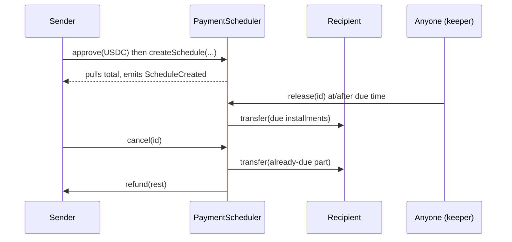

# PaymentScheduler: Design Doc

## 1. Metadata

- Status: Draft (awaiting your confirmation)
- Target chain: Arc Testnet (USDC, ERC-20 view, 6 decimals)
- Language / toolchain: Solidity ^0.8.28, Foundry, OpenZeppelin (installed version)
- Review tracker: [ ] Design  [ ] Security  (Ops / Data / Compliance: N/A, testnet demo)

## 2. Action Items (living)

_Empty. Filled after each review round._

## 3. Goals / Non-Goals

Goals
- A sender locks USDC upfront for a payment to a recipient on a future date, or for a fixed number of recurring installments.
- Funds reach the recipient automatically on schedule, with no admin and no trust in a third party.
- The sender can cancel at any time and recover everything not yet owed to the recipient.
- The recipient can redirect future payments to another address.
- Each schedule can carry a short memo.

Non-Goals
- No admin, owner, pause, fee, or upgrade path.
- No open-ended or "until cancelled" streams: every schedule has a fixed installment count.
- No native-coin payments, no tokens other than the one fixed at deploy.
- No automatic execution inside the contract (a transaction must call `release`; anyone may, so a keeper or the app can do it).
- No partial-amount edits to an existing schedule (cancel and create a new one).

## 4. Requirements

Functional
- F1. `createSchedule` escrows `amountPerInstallment * installments` of USDC from the sender.
- F2. One-time = 1 installment. Recurring = N installments, one every `interval` seconds starting at `startTime`.
- F3. Installment k (1-indexed) becomes due at `startTime + (k-1) * interval`.
- F4. `release` is callable by anyone and pays every installment already due and unreleased, in a single transfer (catch-up), always to the current recipient.
- F5. `cancel` is callable only by the sender. Installments already due are paid to the recipient or, if that payout fails, recorded as `owed`; only future installments are refunded to the sender.
- F6. `reassignRecipient` is callable only by the current recipient and affects all unreleased installments and any owed claim. Cancelled schedules can be reassigned only while `owed > 0`; fully paid schedules with nothing owed cannot be reassigned.
- F7. `claim(id)` is callable by anyone and pays all `owed` to the current recipient. It clears `owed` before a normal reverting transfer; transfer failure restores the claim.

Security (testable assertions)
- S1. Earned installments go only to the current recipient; only future installments may be refunded to the sender on cancellation.
- S2. Total paid out plus refunded for a schedule never exceeds what was escrowed for it; outstanding `owed` remains reserved for the recipient.
- S3. A schedule's escrow can never be used to pay another schedule.
- S4. Nobody can release an installment before its due time.
- S5. No privileged address exists; no function is restricted to a deployer.
- S6. The contract balance is at least the sum of active schedules' remaining installment obligations plus all schedules' `owed` claims.
- S7. A blocked recipient cannot prevent refunding future installments to an otherwise payable sender; their earned funds remain claimable after reassignment. A failed sender refund reverts the whole cancellation; issuer restrictions remain external constraints.

## 5. Terminology & Actors

- Schedule: one escrowed payment plan with an id.
- Installment: one payment of `amountPerInstallment`.
- Due: the installment's due time is at or before `block.timestamp`.

| Actor | On/off-chain | Trust | Can do |
| --- | --- | --- | --- |
| Sender | EOA or contract, onchain | Untrusted | Create schedules, cancel their own |
| Recipient | EOA or contract, onchain | Untrusted | Reassign recipient on their schedule, receive funds |
| Keeper / anyone | Onchain | Untrusted | Call `release` (funds still only go to the recipient) |
| USDC token | Contract | Semi-trusted (blocklist, pause by Circle) | Can block transfers to or from an address |

## 6. Language / Runtime

Solidity ^0.8.28 (checked arithmetic). EVM target as set in `foundry.toml`. Uses OpenZeppelin `SafeERC20`, `ReentrancyGuard`. Not forked from any base design.

## 7. Transaction & Execution Model

All state changes are atomic per call. Every function that moves tokens updates storage first and transfers last (checks, effects, interactions) and also uses `nonReentrant`. No external call other than to the fixed token.

## 8. Chain Standards & Interfaces

- ERC-20 via the ERC-20 view of USDC on Arc. The native-gas view is never used: no `payable` functions, no `msg.value`.
- The token address is a constructor argument, immutable, and must be the Arc Testnet USDC address from the app's `getUsdc(chainId)`.
- EIP-712 / Permit: N/A (the sender approves then calls `createSchedule`; permit support is a possible v2).

## 9. Architecture Overview



Flow of funds

| Step | Who moves what | Invariant |
| --- | --- | --- |
| create | Sender to contract: `amount * n` | Contract balance rises by exactly that (balance-delta checked) |
| release | Contract to recipient: `due * amount` | `paid` rises by `due`; `paid <= total` |
| cancel | Contract to recipient: due part if payable, otherwise retained as owed. Contract to sender: future installments only | Schedule closed; any owed claim remains escrowed |
| claim | Contract to current recipient: full owed amount | Owed cleared; transfer failure restores it |

Resting-state invariant: `USDC.balanceOf(this) >= sum over all schedules of ((installments - paid) * amount + owed)`. Extra USDC sent directly to the contract is unrecoverable by design (no rescue role, see section 17).

Dependencies: the USDC token only.

## 10. Contract Design

### Roles
None. No owner, admin, pauser, or rescuer. This is deliberate (section 19).

### Storage layout

```solidity
struct Schedule {
    address sender;        // immutable after create
    address recipient;     // changeable by recipient
    uint128 amount;        // per installment, in USDC units (6 decimals)
    uint32  installments;  // total count, 1..MAX_INSTALLMENTS
    uint32  paid;          // released installments; set to installments on cancel
    uint48  startTime;     // first due time
    uint32  interval;      // seconds between installments; 0 when installments == 1
    bool    cancelled;
    uint144 owed;          // earned cancellation payout still owed; packed with interval/cancelled
    string  memo;          // <= 64 bytes
}
IERC20 public immutable token;
uint256 public nextId;                              // starts at 1
mapping(uint256 => Schedule) private _schedules;
mapping(address => uint256[]) private _bySender;    // append-only
mapping(address => uint256[]) private _byRecipient; // append on create and reassign; may hold stale entries
```

Constants: `MAX_INSTALLMENTS = 1000`, `MIN_INTERVAL = 1 hours`, `MAX_INTERVAL = 365 days`, `MAX_MEMO_BYTES = 64`.

`owed` uses `uint144`, not `uint128`: up to 1000 installments of a `uint128` amount can be owed at once, exceeding `uint128` but fitting `uint144`. It fits the existing slot with `interval` and `cancelled`, without adding a storage slot. A schedule's outstanding obligation is `(installments - paid) * amount + owed`; cancellation closes installment accounting but retains any unpaid earned amount in `owed`.

Contextual errors: `InvalidRecipient(address recipient)`, `InvalidInstallments(uint32 installments)`, `InvalidInterval(uint32 interval, uint32 installments)`, `IncorrectDeposit(uint256 expected, uint256 actual)`, `UnknownSchedule(uint256 id)`, `ScheduleCancelled(uint256 id)`, `NothingDue(uint256 id)`, `NothingRemaining(uint256 id)`, `NotSender(uint256 id, address caller)`, `NotRecipient(uint256 id, address caller)`. Deposit `actual` is the observed balance increase, or zero if the balance decreased. Trivial zero-value/time/memo validation errors retain their existing signatures.

### Modifiers
- `nonReentrant` on all state-changing functions.

### Functions (write)

| Signature | Caller | State mutated | Events | Reverts |
| --- | --- | --- | --- | --- |
| `createSchedule(address recipient, uint128 amount, uint32 installments, uint48 startTime, uint32 interval, string memo) returns (uint256 id)` | Any | New schedule, id lists, token pulled in | `ScheduleCreated` | recipient is zero, this contract, or the sender; `amount == 0`; `installments` is 0 or above max; `startTime < block.timestamp`; if `installments == 1` then `interval != 0`; if `installments > 1` then interval outside min..max; memo too long; received amount differs from expected |
| `release(uint256 id) returns (uint256 amountPaid)` | Anyone | `paid` increased | `Released` | unknown id; cancelled; nothing due |
| `cancel(uint256 id)` | Sender only | `cancelled = true`, `paid = installments`; failed due payout recorded in `owed`; only future installments refunded | `Cancelled`, `ClaimRecorded` on failed due payout | not sender; unknown id; already cancelled; nothing remaining; sender refund failure (whole call reverts) |
| `claim(uint256 id) returns (uint256 amountPaid)` | Anyone | `owed = 0` before transfer to current recipient | `Claimed` | unknown id; nothing owed; token transfer failure (claim restored) |
| `reassignRecipient(uint256 id, address newRecipient)` | Current recipient only | `recipient`, `_byRecipient`; applies to installments and owed claim | `RecipientChanged` | not recipient; cancelled with nothing owed; fully paid with nothing owed; new address zero, this contract, or unchanged |

Due count (no loop, so no gas growth with schedule length):

```
if now < startTime: due = 0
else if installments == 1: due = installments - paid   // 1 - paid
else: dueTotal = min(installments, 1 + (now - startTime) / interval); due = dueTotal - paid
```

`release`: compute `due`, require `> 0`, set `paid += due`, then transfer `due * amount` to `recipient`.

`cancel`: compute `due` and `remaining = installments - paid`. Set `cancelled = true` and `paid = installments` first. Attempt `due * amount` to the current recipient using a non-reverting transfer. On failure, record that amount in `owed`, emit `ClaimRecorded`, and report zero `paidToRecipient` in `Cancelled`. Refund only `(remaining - due) * amount` with a normal transfer; this refund can never consume `owed`. Skip zero-value transfers. A failed sender refund rolls back the entire cancellation, including any recipient payout, claim, and events.

`claim`: anyone may trigger it when `owed > 0`. Read the full amount, zero `owed`, then use a normal reverting transfer to the current recipient and emit `Claimed`. Failure restores `owed`. It cannot pay the caller or sender instead unless that address is the current recipient. The current recipient may reassign a cancelled schedule while a claim remains outstanding.

Accounting invariant: `USDC.balanceOf(this) >= sum over all schedules of ((installments - paid) * amount + owed)`. Cancellation removes the full remaining installment liability, paying due funds or replacing them with an equal claim, and refunds only future liability. Claiming reduces balance and claim liability by the same amount.

`createSchedule` measures the token balance before and after `transferFrom` and requires the exact total (rejects fee-on-transfer behaviour).

### Functions (read)
`getSchedule(id)` returns the complete struct including `owed`; `releasableAmount(id)` covers installments payable through `release` only (zero after cancellation, even when `owed > 0`); `getSchedulesBySender(addr, offset, limit)`, `getSchedulesByRecipient(addr, offset, limit)` (callers must re-check `recipient` because of stale entries), `scheduleCount()`.

### Events

| Event | Params | When |
| --- | --- | --- |
| `ScheduleCreated` | `id` (indexed), `sender` (indexed), `recipient` (indexed), `amount`, `installments`, `startTime`, `interval`, `memo` | Create |
| `Released` | `id` (indexed), `recipient` (indexed), `installmentsPaid`, `amountPaid`, `caller` | Release |
| `Cancelled` | `id` (indexed), `sender` (indexed), `paidToRecipient`, `refundedToSender` | Cancel; payout is what was actually paid now, refund is future installments only |
| `ClaimRecorded` | `id` (indexed), `recipient` (indexed), `amount` | Failed recipient payout during cancel; amount retained as owed |
| `Claimed` | `id` (indexed), `recipient` (indexed), `amount`, `caller` | Successful claim to current recipient |
| `RecipientChanged` | `id` (indexed), `oldRecipient` (indexed), `newRecipient` (indexed) | Reassign installments or owed claim |

## 11. Specification Tables

Principles: (1) earned funds go only to the current recipient, while the sender can recover only future installments; (2) an installment is never payable before its due time; (3) each installment or owed claim is paid at most once; (4) no address has special power; (5) remaining installment obligations plus owed claims are fully backed by the contract balance.

| Functionality | Restriction | Event |
| --- | --- | --- |
| Create schedule | Anyone, with approval | `ScheduleCreated` |
| Release due installments | Anyone, after due time | `Released` |
| Cancel | Sender only, not cancelled, installments remaining; failed due payout becomes owed | `Cancelled`, `ClaimRecorded` if needed |
| Claim owed cancellation payout | Anyone, `owed > 0`; pays current recipient only | `Claimed` |
| Reassign recipient | Current recipient only; unpaid installments or owed claim required, including cancelled schedules with owed > 0 | `RecipientChanged` |

## 12. Deployment & Initialization

Constructor takes the USDC token address; reverts on zero address. Deployed with the platform deploy flow on Arc Testnet. No roles are set at genesis. Contract holds zero USDC at deploy.

## 13. Upgradeability

None. Immutable. Migration story: contract switch. A fixed bug means a new deployment at a new address; existing schedules keep running on the old contract (senders can cancel and recreate), and the app re-points to the new address.

## 14. Key Management & Signing

N/A. No privileged keys and no off-chain signatures.

## 15. Security Considerations

| Vulnerability | Applicable? | Mitigation |
| --- | --- | --- |
| Reentrancy | Yes, token calls | Effects before interactions, `nonReentrant` |
| Access control | Yes | Sender-only cancel, recipient-only reassign, per-id checks; no admin |
| Overflow / underflow | Checked by Solidity | No `unchecked`; `amount` is `uint128`, total computed in `uint256` |
| Unchecked external call | Yes | `SafeERC20`; non-reverting attempt only in `cancel`, with failed due payout recorded as `owed`; claim uses a normal reverting transfer |
| Fee-on-transfer / rebasing | Yes, in principle | Balance-delta check on create; token is fixed USDC |
| Signature replay | N/A | No signatures |
| Front-running / MEV | Low | Cancel pays already-due installments or preserves them as owed, so a sender cannot claw back earned money by front-running release. Reassignment before release or claim redirects only the recipient's own funds |
| Flash-loan / oracle | N/A | No prices |
| Denial of service | Yes | No loops over schedules; catch-up is arithmetic; paginated views; blocklisted recipient handled in cancel |
| Delegatecall / proxy | N/A | Not upgradeable |
| Timestamp dependence | Yes | Uses `block.timestamp` for due times; seconds-level validator drift is irrelevant at an hour-minimum interval for recurring schedules |
| Approval persistence | Yes | App requests exact-amount approvals only |
| Centralization | None | No privileged role |
| Token blocklist (USDC) | Yes | Release/claim to a blocked recipient reverts; recipient can reassign even after cancellation while owed > 0. Cancel preserves failed earned payouts as owed and refunds only future installments. Blocklisting this contract halts all USDC movement and cannot be mitigated in-contract |
| Direct token donations | Yes | Ignored by accounting; cannot break invariants |
| Reassign to a contract that rejects tokens | Low | Same as blocklist: recipient can reassign again |

## 16. Trust Model & Threat Analysis

There are no privileged actors, so no key compromise can touch other users' funds.

| Actor | Worst case | Mitigation | Detection |
| --- | --- | --- | --- |
| Compromised sender key | Cancels or creates that sender's own schedules | Scope limited to that sender | `Cancelled` events |
| Compromised recipient key | Redirects that recipient's future payments | Scope limited to that recipient's schedules | `RecipientChanged` events |
| USDC issuer (Circle) | Blocklist or pause can freeze transfers | Recipient blocklist: preserve owed on cancel, reassign for release/claim. Contract-address blocklist: no in-contract mitigation | Failed release/claim calls, `ClaimRecorded` events |

If the issuer blocklists the PaymentScheduler contract address itself, all USDC movement into or out of it halts. Reassignment, cancellation, and claims cannot bypass this restriction; it cannot be mitigated in-contract.

## 17. Emergency Response & Circuit Breakers

No pause and no rescue function, by choice. This removes any admin attack surface at the cost of being unable to recover tokens sent directly to the contract or to stop creation of schedules after a bug is found. Incident playbook: stop using the app, tell senders to cancel, deploy a fixed version.

## 18. Failure Scenarios

- Recipient blocklisted: `release` reverts, nothing changes. Recipient reassigns to a clean address, then anyone releases. If the sender cancels instead, failed due payouts remain escrowed as `owed` and only future installments are refunded. The current recipient can reassign the cancelled schedule, then anyone calls `claim` to pay the new recipient.
- Claim transfer fails: the entire claim reverts, restoring `owed`; no earned amount is lost. A second claim after successful payment reverts because nothing remains owed.
- Sender blocklisted: create or nonzero cancel refunds fail; a failed refund rolls back the entire cancellation, including recipient payout or claim recording. Recipient releases are unaffected. A zero refund is skipped.
- Contract address blocklisted by the issuer: all USDC movement halts and no in-contract mechanism can mitigate it.
- Nobody calls `release` for months: one call pays every due installment at once.
- Token transfer reverts during `release`: the whole call reverts, including the `paid` update, so no installment is lost.
- Create with insufficient allowance or balance: reverts, nothing stored.

## 19. Priorities & Tradeoffs

| Decision | Tradeoff | Rationale |
| --- | --- | --- |
| Anyone can trigger release | Third parties pay gas for others | Funds can only go to the recipient, and a keeper or the app can automate it. Recipient-only claim would add friction for no safety gain |
| Cancel pays earned installments or records an owed claim; refunds future installments only | A failed earned payout stays escrowed until a successful claim; recipient can reassign after cancellation | Sender never reclaims earned money, even if USDC rejects the recipient; permissionless claim always pays the current recipient |
| Packed `uint144 owed` | Larger than a single installment amount but no extra storage slot | Covers up to 1000 `uint128` installments without truncation; `uint128 owed` would be insufficient |
| Catch-up in one call | A large lump payment after a long gap | Avoids needing a keeper and avoids loops |
| No admin / immutable | No emergency stop or recovery | Strongest trust story; a testnet demo benefits more from simplicity |
| Memo stored onchain | Costs storage | The app can show it without scanning logs; capped at 64 bytes |
| Rejected: allowance-pull model | Funds could be missing at due time | You chose upfront escrow for guaranteed payment |
| Rejected: native coin escrow | | On Arc, native and ERC-20 USDC are one pool; the ERC-20 view is used for all accounting |

## 20. Testing Strategy

- Foundry unit tests: create validation (every revert), one-time and recurring due math at boundaries (exactly at start, one second before, between installments, after the last), catch-up, cancel before start, mid-way, and after completion, reassign, events.
- Fuzz: due count never exceeds `installments`; total released plus refunded equals total escrowed; no release before start.
- Invariant: contract USDC balance is at least the sum of remaining obligations across active schedules.
- Mock token for a blocklisted recipient and a fee-on-transfer token.
- Static analysis (Slither) with no unresolved high or medium findings.
- Command: `forge test`.

## 21. Third-party libraries

| Lib | Version | Already a dependency? | Why |
| --- | --- | --- | --- |
| OpenZeppelin Contracts | Installed version | Yes | `SafeERC20`, `ReentrancyGuard`, `IERC20`; widely audited |

## 22. Monitoring & Alerting

Index `ScheduleCreated`, `Released`, `Cancelled`, `RecipientChanged` for the app's schedule list. Alert (informational) on repeated reverted `release` calls for the same id, which suggests a blocklisted recipient.

## 23. Cross-Functional Stakeholders

Testnet demo: none beyond you. A mainnet launch would need an independent third-party review.

## 24. Message Encoding

N/A. Single chain, no cross-chain messages.

## 25. Types & Enums

Only the `Schedule` struct above. Status shown in the app is derived: Pending (before `startTime`), Active (`paid < installments`), Completed (`paid == installments`), Cancelled.

## 26. Worked Examples

1. One-time: Alice schedules 100 USDC to Bob for next Friday. She approves 100 USDC and calls `createSchedule(bob, 100e6, 1, friday, 0, "Rent")`. After Friday anyone calls `release(1)`. Bob receives 100 USDC.
2. Recurring with catch-up: Alice schedules 50 USDC monthly for 6 months (interval 30 days), escrowing 300 USDC. Nobody releases for 70 days: `release` finds 3 installments due and pays 150 USDC in one transfer. Alice cancels at day 75: nothing new is due, the remaining 150 USDC returns to her.
